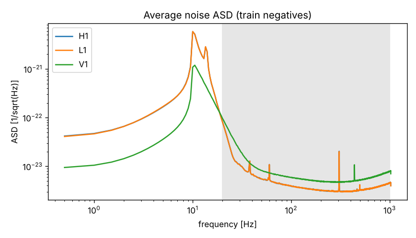
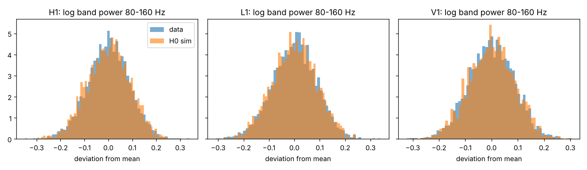
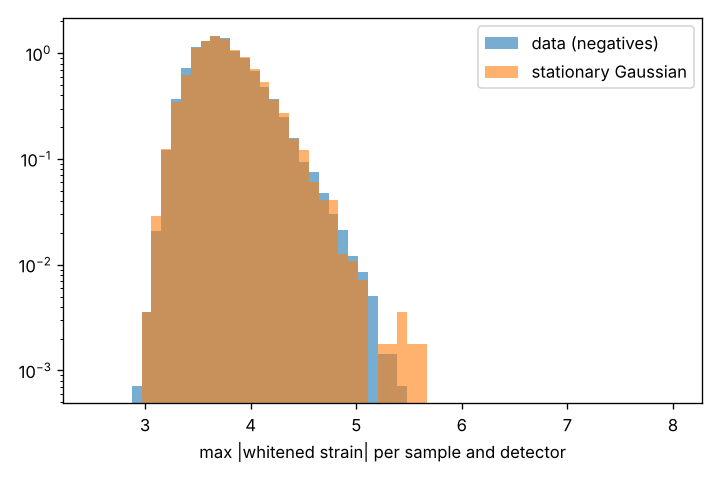
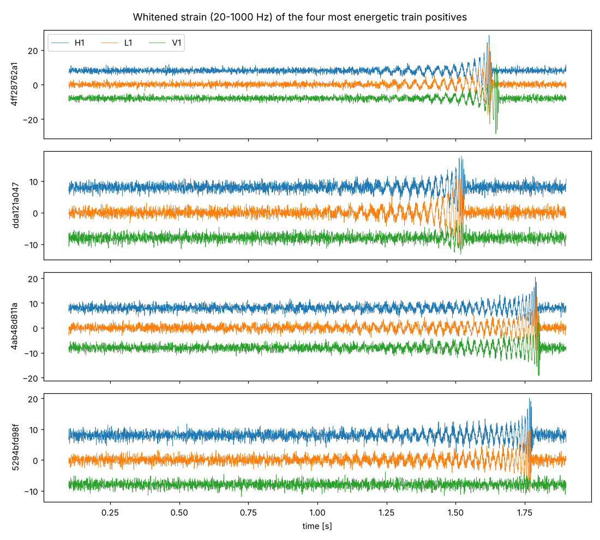

# P0 audit: G2Net raw data

Generated by `python -m gwsciml.audit.p0_audit`. All numbers are recomputable from the
packed subset (kernel `gwsciml/kaggle/pack_subset`) and `training_labels.csv`.

## 1. Split and class balance (full label file)

| split | rows | positive fraction |
|---|---|---|
| val | 150000 | 0.49873 |
| train | 410000 | 0.50030 |
| all | 560000 | 0.49988 |

Audit subset: 10000 train (0.500 positive), 10000 val (0.500 positive),
drawn class-balanced with seed 0 from each split. Raw float64 strain, shape (3, 4096) per sample.

## 2. Average noise PSD

Estimator: periodogram through Tukey(0.1), averaged over the 5000 train negatives
(leakage-inclusive by construction, see `gwsciml/data/psd.py`). Saved as
`data/g2net/packed/psd_avg_train_neg_tukey0.1.npy`.

| detector | ASD 12 Hz | ASD 20 Hz | ASD 50 Hz | ASD 100 Hz | ASD 200 Hz | ASD 500 Hz | val/train PSD ratio 20-500 Hz (mean, max dev) |
|---|---|---|---|---|---|---|---|
| H1 | 2.19e-21 | 8.36e-23 | 5.48e-24 | 3.92e-24 | 3.21e-24 | 3.33e-24 | 1.0010, 0.022 |
| L1 | 2.20e-21 | 8.30e-23 | 5.47e-24 | 3.96e-24 | 3.20e-24 | 3.25e-24 | 1.0007, 0.021 |
| V1 | 7.24e-22 | 9.73e-23 | 8.20e-24 | 5.95e-24 | 4.91e-24 | 5.21e-24 | 1.0003, 0.018 |

The val/train ratio uses 4 Hz groups (32 periodogram bins x ~2,500 samples each), so the
expected sampling scatter is about 0.4 %. Larger deviations would mean the two splits
do not share one noise model.

## 3. Per-sample PSD variation

Statistic: log of the per-sample Welch PSD (Hann, 0.5 s segments, 50 % overlap) averaged
in octave-like bands. `sd data` is its standard deviation over train negatives; `sd H0` is the
same on simulated stationary Gaussian noise with the average PSD. Note the simulation draws
from the leakage-inclusive average PSD without a window, so its Welch estimate is very
slightly different in level; the comparison is about spread, not level.
`excess sd` = sqrt(sd_data^2 - sd_H0^2) is the genuine sample-to-sample PSD variation.

| detector | band [Hz] | sd data | sd H0 | excess sd | excess as factor on PSD |
|---|---|---|---|---|---|
| H1 | 20-40 | 0.2815 | 0.3177 | 0.0000 | x1.000 |
| H1 | 40-80 | 0.1300 | 0.1286 | 0.0196 | x1.020 |
| H1 | 80-160 | 0.0865 | 0.0885 | 0.0000 | x1.000 |
| H1 | 160-320 | 0.1584 | 0.1325 | 0.0869 | x1.091 |
| H1 | 320-640 | 0.0434 | 0.0425 | 0.0092 | x1.009 |
| H1 | 640-1000 | 0.0403 | 0.0410 | 0.0000 | x1.000 |
| L1 | 20-40 | 0.2818 | 0.3094 | 0.0000 | x1.000 |
| L1 | 40-80 | 0.1278 | 0.1293 | 0.0000 | x1.000 |
| L1 | 80-160 | 0.0870 | 0.0857 | 0.0149 | x1.015 |
| L1 | 160-320 | 0.1578 | 0.1326 | 0.0854 | x1.089 |
| L1 | 320-640 | 0.0434 | 0.0431 | 0.0057 | x1.006 |
| L1 | 640-1000 | 0.0408 | 0.0415 | 0.0000 | x1.000 |
| V1 | 20-40 | 0.2548 | 0.2604 | 0.0000 | x1.000 |
| V1 | 40-80 | 0.1258 | 0.1238 | 0.0220 | x1.022 |
| V1 | 80-160 | 0.0867 | 0.0870 | 0.0000 | x1.000 |
| V1 | 160-320 | 0.0609 | 0.0622 | 0.0000 | x1.000 |
| V1 | 320-640 | 0.0437 | 0.0442 | 0.0000 | x1.000 |
| V1 | 640-1000 | 0.0409 | 0.0412 | 0.0000 | x1.000 |

Mean correlation of the band log-powers across bands, within a detector: 0.003
(H0 simulation: 0.007). Correlation between detectors in the 80-160 Hz band:
H1-L1 0.007, H1-V1 0.011, L1-V1 -0.020.

### 3b. Per-frequency-bin test and spectral lines

A bin-resolved test avoids band averaging. For stationary Gaussian noise the periodogram
in each bin is S_k x chi2(2)/2, so cv^2 = var/mean^2 = 1 (sampling sd sqrt(8/n) = 0.052
for n = 3000). Over the 1961 bins in 20-1000 Hz:

| detector | median cv^2 | max cv^2 | expected max (H0, approx.) |
|---|---|---|---|
| H1 | 0.996 | 1.123 | 1.181 |
| L1 | 0.999 | 1.150 | 1.181 |
| V1 | 0.999 | 1.143 | 1.181 |

Spectral lines (average PSD > 3x its 20 Hz running median, 15-1000 Hz), with cv^2 in that bin:

| detector | lines: frequency [Hz] (height, cv^2) |
|---|---|
| H1 | 15 (7x, 0.97), 15.5 (4x, 1.03), 60 (4x, 0.99), 305.5 (7x, 1.00), 306 (35x, 1.12), 306.5 (44x, 0.98), 307 (4x, 0.99) |
| L1 | 15 (7x, 0.96), 15.5 (4x, 1.04), 60 (4x, 0.96), 305.5 (7x, 1.00), 306 (37x, 1.02), 306.5 (43x, 1.03), 307 (4x, 0.98) |
| V1 | 15 (6x, 0.99), 15.5 (5x, 1.00), 16 (4x, 0.96), 438 (5x, 0.97) |

Reading: the band-level excess in 160-320 Hz (H1, L1) in the table above comes from the
306 Hz line dominating the Welch band average; the bin-resolved cv^2 shows no bin, line
bins included, whose power varies more than stationary Gaussian noise allows.

## 4. Gaussianity and glitches (train negatives)

Whitened with the average PSD, band 20-1000 Hz, flat part of the window (0.1-1.9 s),
scaled to unit variance under H0. Kurtosis is excess kurtosis (0 for a Gaussian).

| detector | variance (data) | kurtosis mean (data / H0) | kurtosis sd (data / H0) | max abs y median (data / H0) | P(max abs y > 6) data | P(max abs y > 6) H0 |
|---|---|---|---|---|---|---|
| H1 | 0.9953 | -0.0022 / +0.0001 | 0.0789 / 0.0825 | 3.720 / 3.740 | 0.0000 | 0.0000 |
| L1 | 0.9952 | -0.0027 / -0.0048 | 0.0816 / 0.0791 | 3.720 / 3.717 | 0.0000 | 0.0000 |
| V1 | 0.9995 | -0.0000 / -0.0023 | 0.0804 / 0.0822 | 3.738 / 3.740 | 0.0000 | 0.0000 |

Frequency domain: whitened power per bin divided by its mean over samples should be Exp(1)
for Gaussian noise with a common PSD. KS distance against Exp(1) (200k values, sampling
level ~0.003): H1 0.0019, L1 0.0015, V1 0.0025.

## 5. Signal visibility

Excess band power of train positives over train negatives (mean log ratio, Welch):

| detector | 20-40 Hz | 40-80 Hz | 80-160 Hz | 160-320 Hz | 320-640 Hz | 640-1000 Hz |
|---|---|---|---|---|---|---|
| H1 | +4.52 % | +11.45 % | +4.49 % | +1.65 % | +0.16 % | -0.08 % |
| L1 | +4.43 % | +11.74 % | +4.77 % | +1.52 % | +0.11 % | +0.06 % |
| V1 | +0.02 % | +5.58 % | +2.19 % | +0.82 % | -0.02 % | +0.04 % |

Per-sample whitened variance minus 1 (signal energy / noise energy in the flat window):
positives median +0.0050, 99th percentile +0.1552;
negatives median -0.0036. Most signals carry a tiny fraction of
the sample energy: they are invisible by eye and need a matched filter.

## 6. Frozen baseline (old pipeline, `src/`)

| quantity | value | source |
|---|---|---|
| best val AUC, V2 fusion, no sky features | 0.874 | README.md, developer-notes.md |
| final reported run (sky FiLM, SWA) | 0.865 | README.md |
| sweep band, 100k-sample recipe, 8 configs x 3 seeds | 0.860-0.864 | SWEEP_FINDINGS.md |
| val split | rows 0-149,999 of training_labels.csv | src/model_runs.py shard split |

