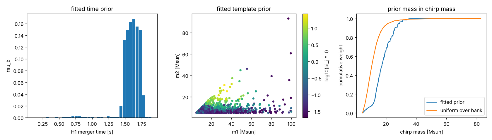
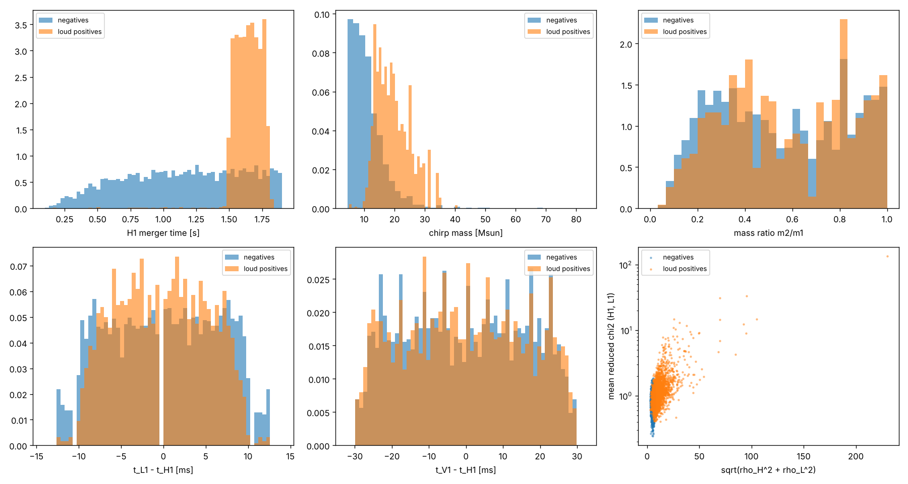

# P2 report: unsupervised parameter estimation and empirical prior

Generated by `python -m gwsciml.pe.p2_analysis`. Train = packed train subset, val = packed
val subset (ROADMAP split). Every prior is fitted on train only and evaluated on val.

## (a) Empirical-Bayes prior (EM on train positives)

EM: 71 iterations, mean log Lambda on train positives 63.8961 -> 65.8843.

| statistic on val | AUC | bootstrap sd |
|---|---|---|
| log Lambda, uniform | 0.8228 | 0.0043 |
| log Lambda, template prior | 0.8364 | 0.0041 |
| log Lambda, time prior | 0.8532 | 0.0039 |
| log Lambda, template x time prior | 0.8727 | 0.0036 |
| log Lambda, joint template-time prior, alpha 0.1 | 0.8559 | 0.0038 |
| log Lambda, joint template-time prior, alpha 1 | 0.8355 | 0.0041 |
| log Lambda, joint template-time prior, alpha 10 | 0.8250 | 0.0043 |
| P1 inc_max | 0.8167 | 0.0045 |
| P1 inc_lse | 0.8224 | 0.0043 |
| P1 coh_max | 0.8215 | 0.0043 |
| P1 rw_net2 | 0.8004 | 0.0047 |

Time prior: 0.976 of the weight lies at H1 merger times > 1.4 s.
Template prior: weighted median chirp mass 17.3 Msun
(uniform-over-bank median 10.7 Msun).

## theta-hat: maximum-likelihood point estimates

theta-hat = (template, H1 merger time, sky) of the largest coherent statistic. For
negatives it is pure noise fitting, so the contrast with positives shows which parameters
the data constrain. `loud` = val positives with coh_max above the 99th percentile of val negatives.

Threshold coh_max = 52.4; loud positives: 2707 of 5000 (0.541).

| quantity | negatives median (IQR) | loud positives median (IQR) |
|---|---|---|
| H1 merger time [s] | 1.17 (0.788-1.54) | 1.65 (1.57-1.72) |
| chirp mass [Msun] | 9.72 (7.02-13.1) | 18.7 (15.1-23.4) |
| mass ratio | 0.529 (0.315-0.808) | 0.551 (0.351-0.811) |
| abs(t_L1 - t_H1) [ms] | 5.37 (2.44-8.3) | 4.39 (2.44-6.84) |
| abs(t_V1 - t_H1) [ms] | 13.7 (7.32-21) | 13.2 (6.35-21) |
| rho_H | 3.85 (3.04-4.6) | 6.52 (5.02-8.86) |
| rho_L | 3.69 (3-4.44) | 6.56 (5.07-8.93) |
| rho_V | 3.87 (3.23-4.55) | 4.36 (3.27-6.17) |
| null energy at coherent max | 0.829 (0.352-1.59) | 1.28 (0.502-2.6) |
| chi2_r H1 | 0.823 (0.617-1.04) | 1.08 (0.787-1.46) |
| chi2_r L1 | 0.798 (0.606-1.03) | 1.04 (0.768-1.44) |

## Missing-physics check (template-family mismatch)

If the true signals are in the bank's family (non-spinning IMRPhenomD), the Allen chi2 of
a loud signal stays near 1 (chi2 with 2p-2 dof divided by its dof). A mismatch 1 - m between
signal and best template adds about rho^2 (1 - m) x O(1) to chi2 (the residual power that
the template does not absorb is distributed across bands), so chi2_r grows with rho^2.

| rho_H1,L1 bin | n | median chi2_r H1 | median chi2_r L1 | median null energy |
|---|---|---|---|---|
| 0-8 | 3207 | 0.87 | 0.84 | 0.83 |
| 8-12 | 1062 | 1.01 | 1.02 | 1.14 |
| 12-16 | 367 | 1.24 | 1.17 | 1.80 |
| 16-24 | 251 | 1.47 | 1.44 | 2.65 |
| 24-40 | 85 | 2.25 | 1.89 | 3.08 |
| 40-200 | 27 | 4.20 | 3.88 | 13.16 |
| negatives | 5000 | 0.82 | 0.80 | 0.83 |

